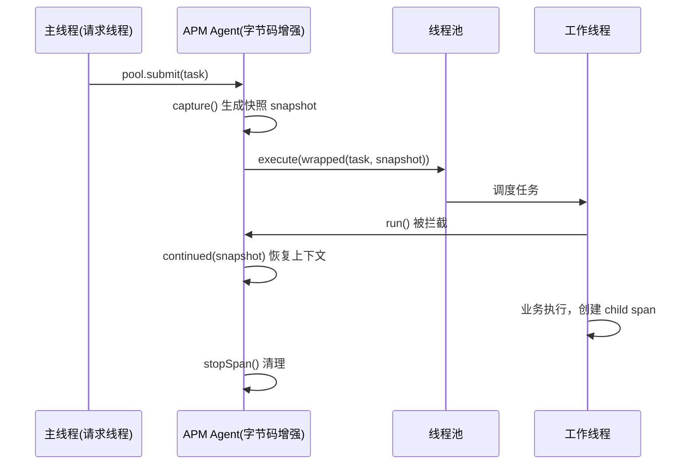

# APM 链路追踪中跨线程透传原理的讲解：InheritableThreadLocal 为什么不行

> 一次请求被异步线程"接走"之后，trace 上下文是怎么跟着任务一起跑到另一个线程的？
>
> Java 为线程间传值提供了 `InheritableThreadLocal`，但它在 APM 场景下**必然失效**——继承时机和我们要的时机根本不是一回事。
>
> 本文分三步讲清跨线程透传：先拆解 `InheritableThreadLocal` 的三个失效模式，再手写一个最小可运行的 demo 把 **Capture → Transfer → Restore** 跑通，最后和 OpenTelemetry、阿里 TTL 做实现层面的对照——三者的本质其实是同一个模式。
>
> 文中所有代码示例与运行输出均已实测（JDK 17 + Maven）。

配套可运行的最小 demo 见 [`src/main/java/com/zz`](./src/main/java/com/zz)。

---

## 目录

1. [背景：链路为什么会断在半路](#1-背景链路为什么会断在半路)
2. [基础：trace 上下文与 ThreadLocal](#2-基础trace-上下文与-threadlocal)
3. [为什么 InheritableThreadLocal 不行](#3-为什么-inheritablethreadlocal-不行)
4. [正确方案：Capture → Transfer → Restore](#4-正确方案capture--transfer--restore)
5. [本仓库的 demo 实现与实跑验证](#5-本仓库的-demo-实现与实跑验证)
6. [真实 APM 是怎么做的：字节码增强](#6-真实-apm-是怎么做的字节码增强)
7. [与 OpenTelemetry 对比](#7-与-opentelemetry-对比)
8. [顺带一提：TransmittableThreadLocal (TTL)](#8-顺带一提transmittablethreadlocal-ttl)
9. [三种实现的对照关系](#9-三种实现的对照关系)
10. [踩坑清单](#10-踩坑清单)
11. [总结](#11-总结)

---

## 1. 背景：链路为什么会断在半路

APM（Application Performance Monitoring，应用性能监控）通过 `traceId` / `spanId` 把一次请求在多个服务、多个方法之间的调用串成一条调用链，从而回答"这次慢到底慢在哪一环"。但排查一个接口耗时问题时，监控平台上看到的链路是这样的：

```
Gateway  200ms
  └─ OrderService.createOrder  180ms
       └─（异步线程）           175ms   ← 根节点，孤零零一个
```

根节点冒出来了——异步部分的 span 没能挂到主链路上，整条链路在 `OrderService` 之后就断了，耗时归因完全失效。

原因不复杂：trace 上下文在**同一个线程**内是存放在 `ThreadLocal` 里的，方法间直接读就行：

```java
// 请求入口线程
ContextManager.setCurrentContext(traceContext);   // 存进 ThreadLocal
doBusiness();                                      // 内部方法从 ThreadLocal 读同一个上下文
ContextManager.removeContext();                    // 请求结束清理
```

但现代服务大量使用异步 / 并发编程（线程池、`CompletableFuture`、Netty / Reactor / RxJava 等），一个请求会从一个线程"跳"到另一个线程继续执行。**`ThreadLocal` 是线程私有的，线程一换，上下文就"丢"了**——新线程里产生的 span 找不到父 span，就成了孤儿。

于是问题变成：

> **如何把「提交任务那一刻」线程上的 trace 上下文，带到「执行任务那一刻」的线程上，并正确续接调用链。**

这里藏着整个问题的关键——**"提交那一刻"和"执行那一刻"是两个不同的时刻，中间还隔着一个"任务被缓存起来"的异步队列**。Java 官方的 `InheritableThreadLocal` 之所以失效，根源就在于它工作的时机是"线程创建时"，而不是我们需要的"任务提交时"。下面第 3 章的失败案例，全部源于搞错了这个时机。

### 本文要回答的三个问题

| # | 问题 | 对应章节 |
|---|---|---|
| 1 | 为什么官方提供的 `InheritableThreadLocal` 在这个场景下必然失效？ | [第 3 章](#3-为什么-inheritablethreadlocal-不行) |
| 2 | 正确的做法是什么，能不能自己写一个最小实现跑通？ | [第 4-5 章](#4-正确方案capture--transfer--restore) |
| 3 | 主流 APM / OTel / TTL 是怎么做的，有何异同？ | [第 6-9 章](#6-真实-apm-是怎么做的字节码增强) |

---

## 2. 基础：trace 上下文与 ThreadLocal

先明确一点：trace 上下文本质上是一个"跟着线程走"的状态。主流实现都把它放进 `ThreadLocal`，因为：

- 每个请求线程有自己的上下文，互不干扰；
- 取用零参数，业务代码完全无感（不用层层传参）；
- 请求结束时 `remove()` 就能清理，避免线程池复用时的污染。

`ThreadLocal` 的局限也正是从这里来的——它是**线程私有**的。线程一旦切换，上下文就"丢"了。Java 提供了一个看起来能解决父子线程共享的 `InheritableThreadLocal`，但它解决不了我们的问题，下面细说。

---

## 3. 为什么 InheritableThreadLocal 不行

先看 `InheritableThreadLocal` 的实现原理：

```java
public class InheritableThreadLocal<T> extends ThreadLocal<T> {
    protected T childValue(T parentValue) {
        return parentValue;   // 默认直接返回父值，子类可覆写做拷贝
    }
    ThreadLocalMap getMap(Thread t) {
        return t.inheritableThreadLocals;      // 用的是线程的另一张表
    }
    void createMap(Thread t, T firstValue) {
        t.inheritableThreadLocals = new ThreadLocalMap(this, firstValue);
    }
}
```

关键在 `Thread` 构造器里的这段逻辑（`java.lang.Thread` 内部）：

```java
if (parent.inheritableThreadLocals != null)
    this.inheritableThreadLocals =
        ThreadLocal.createInheritedMap(parent.inheritableThreadLocals);
```

也就是说，子线程的 `InheritableThreadLocal` 值，是在 **`new Thread()` 那一瞬间**从父线程拷贝过来的。此后父子各用各的，再无关系。

### 3.1 三个时机，三个 confusion

这是理解本文的**核心心智模型**。上下文传递有三个可能的时机，语义完全不同：

| 时机        | 触发动作                | `InheritableThreadLocal` 支持？ | APM 需要？    |
| --------- | ------------------- | ---------------------------- | ---------- |
| **线程创建时** | `new Thread()`      | ✅ 正是它的语义                     | ❌ 太早了      |
| **任务提交时** | `pool.submit(task)` | ❌ **不支持**                    | ✅ **正是要的** |
| **任务执行时** | 工作线程里 `run()`       | ❌ 不支持                        | ✅ 也要（恢复动作） |

一句话：`InheritableThreadLocal` 解决的是"父子线程在**创建时**共享初始值"，而 APM 要的是"线程池里**每次任务提交时**传递当时的上下文"。两者根本不是一回事。

下面三个小节分别对应三个具体失败模式，都有实跑输出。

### 3.2 失败模式一：继承时机是"线程创建时"，不是"任务提交时"

```java
InheritableThreadLocal<String> itl = new InheritableThreadLocal<>();

Thread t = new Thread(() -> System.out.println("child: " + itl.get()));

itl.set("traceId-123");   // 在 new 之后、start 之前设置 —— 没用
t.start();
// 输出：child: null
```

值在 `new Thread()` 时就已经拷贝了，那时 `itl` 还是 `null`。而真实场景里，trace 上下文一定是"请求来了之后"才设置到 `ThreadLocal` 上的，永远晚于线程创建。

验证程序见 [`ItlDemo#demo3_1`](./src/main/java/com/zz/ItlDemo.java)，实跑输出：

```
=== 论断 3.1：继承发生在 new Thread() 瞬间，而非 start() ===
  父线程 set("traceId-123") 完成，时机在 new Thread() 之后
  子线程读到: null   <- 期望是 traceId-123，实际 null
```

> 顺带一提：这也是为什么 `Thread.start()` 而不是 `Thread.run()` 是必须的——继承发生在构造期，而 `run()` 的调用时机完全由调度器决定，两者根本不挂钩。

### 3.3 失败模式二：线程池复用线程，值被"定格"在创建时

```java
ExecutorService pool = Executors.newSingleThreadExecutor();
InheritableThreadLocal<String> itl = new InheritableThreadLocal<>();

itl.set("traceId-A");
pool.submit(() -> System.out.println("task1: " + itl.get())); // "A" —— 线程此时才创建，继承了 A

itl.set("traceId-B");
pool.submit(() -> System.out.println("task2: " + itl.get())); // 还是 "A"！正确应是 "B"
```

第一次 `submit` 触发线程池创建唯一的工作线程，把 `traceId-A` 拷了进去。第二次 `submit` 复用同一个线程，线程里的值仍然是 `traceId-A`——**拿到了上一个请求的脏数据**，这就是链路串扰（污染）。

实跑输出：

```
=== 论断 3.2：线程池复用线程，值被定格在创建那一刻 ===
  task1 读到: traceId-A   <- 期望 A
  task2 读到: traceId-A   <- 期望 B，实际 A，链路串扰
```

**这个案例最致命**，因为它不报错、不抛异常，只是安静地把 A 请求的 span 挂到了 B 请求的链路上——等到你在监控平台上看到一条链路里混进了两个用户的请求时，已经过了很久了。

顺带说明另一个坑：`Executors.newFixedThreadPool(n)` 里的核心线程是**懒创建**的，第一个 `submit` 才真正 `new Thread()`。这意味着**谁先 submit，谁的值就被定格**——完全不可预期。

### 3.4 失败模式三：单向、一次性、浅拷贝

继承只发生在创建那一瞬间；之后父线程再 `set` 不会同步给子线程，子线程的修改也不会回写。它是"快照一次"，而不是"每次任务都传递一次"。

实跑输出：

```
=== 论断 3.3：单向、一次性，父线程后续 set 不会同步 ===
  子线程内 set 后读到: child-modified
  子线程结束，父线程读到: parent-value   <- 子线程的修改未回写
```

另外注意 `childValue` 默认返回**引用**而非深拷贝，如果传递的是可变对象，父子线程会共享同一个实例——这也是阿里 TTL 文档里明确警告的点：**跨线程传递引用后对象不再有线程封闭性，业务要自己保证线程安全**。

---

## 4. 正确方案：Capture → Transfer → Restore

正确思路是显式地在三个时间点做三件事：

| 步骤                 | 时机      | 动作                                             |
| ------------------ | ------- | ---------------------------------------------- |
| **Capture（捕获）**    | 提交任务的线程 | 把当前 trace 上下文打包成一个不可变快照                        |
| **Transfer（传递）**   | 提交与执行之间 | 把快照塞进任务对象（包装 `Runnable`/`Callable`，或字节码给任务加字段） |
| **Restore（恢复/续接）** | 执行任务的线程 | 把快照恢复到该线程的 `ThreadLocal`，基于它创建子 span，执行完清理     |

伪代码：

```java
// 提交线程（父）
ContextSnapshot snapshot = ContextManager.capture();   // 1. 捕获快照

Runnable wrapped = () -> {
    ContextManager.continued(snapshot);                // 3a. 恢复上下文，续接链路
    try {
        original.run();                                 // 业务里创建的 span 自动挂到父 span 下
    } finally {
        ContextManager.stopSpan();                      // 3b. 结束并清理，避免污染线程
    }
};

pool.execute(wrapped);                                 // 2. 提交的是包装后的任务
```

为什么这样能工作？关键在于**快照是自包含的不可变对象**：它记住了父 span 的 `traceId` / `spanId` / `segmentId` 等全部信息，不依赖任何线程状态。无论任务在哪个线程、什么时候执行，都能据它重建上下文。

还要注意一个语义上的细节：跨线程透传**不是简单地把 `traceId` 复制过去**，而是"续接"（continue）——在新线程里创建一个**新的子 span**，其 `parentId` 指向快照里那个父 span。这样才能画出正确的调用树：异步任务不是主链路的一部分，而是主链路分出来的一个子分支。

### 4.1 为什么必须"备份 / 还原"，而不能直接 set

一个容易被忽略的细节：**工作线程是被复用的，它可能已经有自己的上下文**（上一个任务没清干净的残留，或者是 agent 在线程池初始化时预置的上下文）。

所以正确做法是**先备份、执行完再还原**，而不是简单地 `set` 完就不管了：

```java
public void run() {
    T backup = threadLocal.get();      // 备份工作线程原来的值
    if (snapshot != null) {
        threadLocal.set(snapshot);     // 恢复本次任务的上下文
    } else {
        threadLocal.remove();          // 快照为空也要显式 remove，不能留着旧值
    }
    try {
        runnable.run();
    } finally {
        if (backup != null) {
            threadLocal.set(backup);   // 还原，避免串扰
        } else {
            threadLocal.remove();
        }
    }
}
```

这里的 `finally` 是**刚性要求**——任务体抛异常时如果不还原，工作线程就被污染了，而线程池不会帮你清理。后面 3.4 节的实跑输出里第5 行 `[未包装] 复用线程读到: null` 就是对这条的实测验证。

另一个细节：`snapshot == null` 时必须走 `remove()` 分支而不是"什么都不做"。如果偷懒不处理，当提交线程本身没有上下文时，工作线程就会残留上一个任务的值。

---

## 5. 本仓库的 demo 实现与实跑验证

上面这套"捕获 → 传递 → 恢复 + 备份/还原"，正是 [`TraceRunner`](./src/main/java/com/zz/TraceRunner.java) 和 [`TraceCallable`](./src/main/java/com/zz/TraceCallable.java) 干的事。

`TraceRunner` 包装一个 `Runnable`，**构造时**捕获快照，`run()` 时先备份再恢复，`finally` 里还原：

```java
public class TraceRunner<T> implements Runnable {

    private final T snapshot;             // 构造时捕获的上下文快照
    private final ThreadLocal<T> threadLocal;
    private final Runnable runnable;

    public TraceRunner(Runnable runnable, ThreadLocal<T> threadLocal) {
        this.runnable = runnable;
        this.snapshot = threadLocal.get();   // Capture：在提交侧捕获
        this.threadLocal = threadLocal;
    }

    @Override
    public void run() {
        T backup = threadLocal.get();        // 备份工作线程原值
        if (snapshot != null) {
            threadLocal.set(snapshot);       // Restore：在执行侧恢复本次上下文
        } else {
            threadLocal.remove();
        }
        try {
            runnable.run();
        } finally {
            if (backup != null) {            // 还原，防止线程复用串扰
                threadLocal.set(backup);
            } else {
                threadLocal.remove();
            }
        }
    }
}
```

`TraceCallable` 同理，只是包装 `Callable`（实现 `Callable<T>`，能正常返回结果）。这两处就是整套机制的"最小可运行"版本。

**关键设计点：捕获发生在构造器里。** 因为 `new TraceRunner<>(task, TRACE)` 这行代码本身就是在提交线程上执行的，构造器一执行就完成了快照——这正是"提交时捕获"的语义。如果把捕获挪到 `run()` 里，就变成"执行时捕获"了，快照里会是工作线程自己的上下文，完全失去意义。

### 5.1 入口 Demo 的四个场景

[`Main`](./src/main/java/com/zz/Main.java) 用一个 `ThreadLocal<String>` 模拟 trace 上下文（真实场景里是 `TraceContext` 对象），用一个**单线程池**保证任务按序执行，方便观察"备份/还原"的效果：

```java
// 用 ThreadLocal<String> 模拟 APM 的 trace 上下文
static final ThreadLocal<String> TRACE = new ThreadLocal<>();

ExecutorService pool = Executors.newSingleThreadExecutor();

// 1) 直接提交：上下文丢失，工作线程读到 null
TRACE.set("traceId-1");
pool.submit(() -> System.out.println("[直接提交] 工作线程读到: " + TRACE.get()));

// 2) TraceRunner 包装：上下文透传
TRACE.set("traceId-2");
pool.submit(new TraceRunner<>(
        () -> System.out.println("[TraceRunner] 工作线程读到: " + TRACE.get()),
        TRACE
));

// 3) TraceCallable 包装：上下文透传 + 能拿到返回值
TRACE.set("traceId-3");
Future<String> future = pool.submit(new TraceCallable<>(
        () -> TRACE.get(),   // 在工作线程里读取透传过来的值
        TRACE
));
System.out.println("[TraceCallable] 工作线程读到: " + future.get());

// 4) 任务执行完已还原：下一个未包装的任务拿不到脏数据
TRACE.set("traceId-4");
pool.submit(new TraceRunner<>(
        () -> System.out.println("[TraceRunner] 复用线程读到: " + TRACE.get()),
        TRACE
));
pool.submit(() -> System.out.println("[未包装] 复用线程读到: " + TRACE.get()));

pool.shutdown();
```

### 5.2 实跑输出

编译运行（JDK 17）：

```bash
javac -encoding UTF-8 -d target/classes src/main/java/com/zz/*.java
java -cp target/classes com.zz.Main
```

实际输出：

```
[直接提交] 工作线程读到: null
[TraceRunner] 工作线程读到: traceId-2
[TraceCallable] 工作线程读到: traceId-3
[TraceRunner] 复用线程读到: traceId-4
[未包装] 复用线程读到: null
```

逐行解读：

| 输出行                               | 说明                                                                                              |
| --------------------------------- | ----------------------------------------------------------------------------------------------- |
| `[直接提交] ... null`                 | 对照组：裸 `submit` 不透传，`ThreadLocal` 不跨线程                                                           |
| `[TraceRunner] ... traceId-2`     | 场景 2：包装后快照正确送达                                                                                  |
| `[TraceCallable] ... traceId-3`   | 场景 3：`Callable` 同样生效，且返回值能带回提交线程                                                                |
| `[TraceRunner] 复用线程读到: traceId-4` | 场景 4 前半：同一个工作线程（复用），拿到了**本次**提交的 `traceId-4`，而不是上一轮的 `traceId-3`                                |
| `[未包装] 复用线程读到: null`              | **场景 4 后半，也是最关键的一行**：上一个 `TraceRunner` 在 `finally` 里把线程还原了，所以这个未包装任务读到的是 `null` 而不是 `traceId-4` |


最后两行连起来看，证明了 `finally` 里的还原逻辑生效：工作线程用完即还原，**不留脏数据给下一个任务**。这正是第 4.1 节强调的"备份/还原"的价值。

> 真实 APM 里的快照不是泛型 `T`，而是一个具体的 `TraceContext`（包含 `traceId` / `spanId` / `parentSpanId` / `segmentId` 等），但骨架完全一样。

---

## 6. 真实 APM 是怎么做的：字节码增强

如果让业务自己每次提交任务都写上面那层 wrapper，太麻烦也太容易漏。真实 APM（以 SkyWalking 为例，Pinpoint 思路一致）的价值在于**通过 Java Agent + 字节码增强把它透明化**：

- 通过 `java -javaagent:skywalking-agent.jar` 启动，用 ASM 改写类字节码。
- **提交点拦截**：增强 `ThreadPoolExecutor.execute/submit`、`CompletableFuture`、`ForkJoinTask` 等方法，在提交前调用 `ContextManager.capture()` 捕获快照，把传入的 `Runnable`/`Callable` 自动包装成带快照的 wrapper。
- **执行点拦截**：增强 `Runnable.run()` / `Callable.call()`，在工作线程里先 `ContextManager.continued(snapshot)` 恢复上下文，执行完 `stopSpan()` 清理。

业务代码完全无感，一个普通的线程池异步任务也能自动挂到主链路上。



> 不同版本的具体类名（如 `ContextSnapshot`、`ContextManager.capture/continued`）可能有出入，但"提交处包装、执行处续接"的骨架不变。

### 6.1 字节码增强的代价

透明是有代价的，理解这些代价能帮助你判断何时该用 agent、何时该手动包装：

1. **有损（lossy）**——这是最实质的限制。agent 只能拦截它**认识**的提交点（`ThreadPoolExecutor`、`ForkJoinTask`、`CompletableFuture` 等）。如果你用了自研的异步框架、`Thread` 直接 `new`、或者某些框架内部自建的执行器，agent 看不见，链路照样断。
2. **启动开销**——`-javaagent` 会加载 ASM 做字节码转换，冷启动变慢（通常几十到几百毫秒）。
3. **可观测性差**——出问题时你看到的是"agent 干的"，缺少显式的 API 抓手去打断点、去验证。

所以实际工程里往往是**混合模式**：agent 打底保证覆盖率，关键链路自己用 API 补上。

---

## 7. 与 OpenTelemetry 对比

OpenTelemetry 用另一套更"标准、显式"的模型解决同样的问题。

### 7.1 OTel 的 Context 模型

- **`Context` 是不可变对象**：用 `Context` 保存当前 `Span` 和 `Baggage`。`Context.current()` 从基于 `ThreadLocal` 的 `ContextStorage` 里取（源码 `ContextStorage.defaultStorage()` 返回 `ThreadLocalContextStorage`）。
- **跨线程传播靠 `wrap`**：`Context.current().wrap(runnable)` 在**提交侧**捕获当前 Context，包装后的任务在**执行侧**自动 `makeCurrent()` 设为当前，跑完 `close()` 恢复。
- **推荐整体包装线程池**：`Context.taskWrapping(executorService)` 一次性包住整个线程池，避免逐个 submit 点遗漏。

```java
Span parentSpan = tracer.spanBuilder("parent").startSpan();
try (Scope scope = parentSpan.makeCurrent()) {
    // 推荐：直接包线程池
    ExecutorService traced = Context.taskWrapping(Executors.newFixedThreadPool(8));

    traced.submit(() -> {
        // 这里 Context.current() 已被自动恢复为提交时捕获的 context
        Span child = tracer.spanBuilder("child").startSpan();  // 父= parentSpan
        child.end();
    });
} finally {
    parentSpan.end();
}
```

### 7.2 与本仓库 demo 的逐行对应

有意思的是，把 OTel 的 API 和本文的 `TraceRunner` 并排放，会发现它们**几乎是同一段代码的不同命名**：

| 语义          | 本文 demo                        | OpenTelemetry                | 阿里 TTL                                     |
| ----------- | ------------------------------ | ---------------------------- | ------------------------------------------ |
| 上下文载体       | `ThreadLocal<T>`               | `Context`（不可变 KV）            | `TransmittableThreadLocal<T>`              |
| 捕获（提交侧）     | 构造器里 `threadLocal.get()`       | `Context.current()`          | `captureAllTtlValues()`                    |
| 传递载体        | `TraceRunner` 持有 `snapshot` 字段 | `wrap()` 返回的 `Runnable`      | `TtlRunnable` 持有 captured map              |
| 恢复（执行侧）     | `threadLocal.set(snapshot)`    | `makeCurrent()`              | `replayCapturedTtlValues()`                |
| 还原（finally） | 备份/`set(backup)` 或 `remove()`  | `Scope.close()`              | `restoreTtlValuesAfterExecution()`         |
| 线程池级包装      | 无（需自己包）                        | `Context.taskWrapping(pool)` | `TtlExecutors.getTtlExecutorService(pool)` |

**三者的本质是同一个模式**：在提交侧抓快照 → 绑在任务对象上 → 执行侧回放 → finally 还原。差别只在载体（泛型 `T` vs 不可变 `Context`）和包装粒度。

### 7.3 核心对比

| 维度 | APM（SkyWalking / Pinpoint） | OpenTelemetry |
|---|---|---|
| 核心机制 | 字节码增强，自动捕获 / 续接快照 | 不可变 `Context` + `wrap` / `makeCurrent` |
| 是否改代码 | 否（`-javaagent` 即可） | 手动用 SDK 需显式 `wrap`；用 Java agent / instrumentation 库则自动 |
| 上下文载体 | 厂商私有 `TraceContext` / `ContextSnapshot` | 标准 `Context`（符合 W3C Trace Context） |
| 传播语义 | `capture` / `continued` 快照续接 | `wrap` 捕获当前 Context，`makeCurrent` 恢复 |
| 标准与生态 | 各厂商各自实现 | 跨语言统一规范 + 可插拔 exporter |
| 跨进程协议 | 厂商自有（如 SkyWalking v3 协议） | W3C Trace Context / B3 等标准 |
| 覆盖不到的异步场景 | 有（agent 看不见的提交点） | 同样有（`Context.wrap` 也是显式的） |

### 7.4 一点澄清

OpenTelemetry 也有 Java agent（`opentelemetry-javaagent`），它同样用字节码增强自动传播 context。二者真正的区别在于**抽象层**：

- **OTel** 提供了一套**标准 API**（`Context` / `wrap` / `makeCurrent`），无论有没有 agent、无论换哪个 exporter，语义一致、可移植；agent 只是"替你调用这套 API"。
- **传统 APM** 的透传是**厂商私有实现**，你依赖的是某个 agent 的行为，而不是一个公开标准；换厂商就要换 agent。

换句话说：SkyWalking 把能力藏在 agent 里、对你是黑盒；OpenTelemetry 把能力提炼成公开 API、对你是白盒。

### 7.5 OTel 的严格模式：一个值得抄的调试设计

OTel 在 `Context` 的 Javadoc 里提了个内建调试开关：

```bash
-Dio.opentelemetry.context.enableStrictContext=true
```

它会启用 `StrictContextStorage`，通过**遍历调用栈**来校验：

- `Scope` 是否在**正确的线程**上关闭；
- `Scope` 是否被 GC 之前就 close（泄漏检测）。

它还能检测 Kotlin 协程里的非法 `makeCurrent()`（依赖 kotlinx-coroutines 内部 API，跨版本可能失效）。官方建议在单测和预发环境常开，代价是栈遍历开销。

> 这个设计的价值在于：把"上下文用错了"这类**静默失败**（不抛异常、只是链路断掉）变成**显式失败**。第 3.3 节那个串扰案例之所以难查，正是因为它不报错。
>
> 如果你在自研 APM 框架，这一条非常值得借鉴——一个可选的 strict 模式，往往能在联调阶段省下几天。

---

## 8. 顺带一提：TransmittableThreadLocal (TTL)

阿里巴巴开源的 [TransmittableThreadLocal](https://github.com/alibaba/transmittable-thread-local)（TTL）正是为补上 `InheritableThreadLocal` 在线程池下的坑而生的。README 里的一句话把定位说得最准：

> JDK 的 `InheritableThreadLocal` 类可以完成父线程到子线程的值传递。但对于使用线程池等会**缓存线程**的组件的情况，线程由线程池创建好，并且线程是缓存起来反复使用的；这时父子线程关系的 ThreadLocal 值传递已经没有意义，应用需要的实际上是把**任务提交给线程池时**的 ThreadLocal 值传递到**任务执行时**。

这句话和本文第 3 章的结论完全一致。

### 8.1 TTL 的做法

TTL 继承 `InheritableThreadLocal`（保留了直接 `new` 子线程场景的能力），并在 `InheritableThreadLocal` 之上补了两件事：

1. **`copy()` 方法**——定制"提交时"到"执行时"的拷贝行为，缺省传递引用（和 `childValue` 一样，不做深拷贝）。
2. **`beforeExecute` / `afterExecute` 生命周期回调**——缺省是空操作，留给子类扩展。

它的内部三阶段命名，可以直接和本文的模型对上：

| 阶段 | TTL 内部方法                                      | 对应本文                                    |
| -- | --------------------------------------------- | --------------------------------------- |
| 捕获 | `captureAllTtlValues()`                       | `newTraceRunner(...)` 构造器               |
| 传递 | `TtlRunnable` / `TtlCallable` 持有 captured map | `snapshot` 字段                           |
| 恢复 | `replayCapturedTtlValues()`                   | `threadLocal.set(snapshot)`             |
| 还原 | `restoreTtlValuesAfterExecution()`            | `finally` 里的 `set(backup)` / `remove()` |

### 8.2 三种使用粒度

```java
// 1) 修饰单个任务
Runnable ttlRunnable = TtlRunnable.get(task);
executorService.submit(ttlRunnable);

// 2) 修饰线程池（推荐，省去逐个 submit 的修饰）
ExecutorService traced = TtlExecutors.getTtlExecutorService(executorService);

// 3) Java Agent：修饰 JDK 线程池实现类，完全无侵入
//    -javaagent:path/to/transmittable-thread-local-2.x.y.jar
```

Agent 模式目前增强的 JDK 组件：`ThreadPoolExecutor`、`ScheduledThreadPoolExecutor`、`ForkJoinTask`（2.5.1+，因此透明支持了 `CompletableFuture` 与并行 `Stream`）、`TimerTask`（2.7.0+，2.11.2 起默认开启）。

### 8.3 TTL 与 APM 的关系：不是替代，是互补

这点容易混淆，说清楚：

- **TTL 解决的是"值的传递"**——任意 `ThreadLocal` 值在池化线程间流转，属于**通用基础设施**。
- **APM 解决的是"调用链的续接"**——除了传值，还要基于父 span 创建**新的子 span**、维护 span 生命周期、保证 span 采样决策一致、串联 trace/spanId 关系，属于**领域逻辑**。

所以正确的做法是：**在 APM 内部用 TTL 来跑马甲**。把 trace 上下文存进 `TransmittableThreadLocal`，就免费获得了池化场景的透传能力，不必自己实现 `TtlRunnable` 那套。这正是 TTL 官方文档里把"分布式跟踪系统"列为第一目标场景的原因。

不过即便如此，APM 也不能完全依赖 TTL——字节码增强的透明性、内部 span 生命周期管理、跨进程协议传播，这些都不是 TTL 的职责范围。

### 8.4 TTL 的已知失效场景

官方文档明确列出了几种 TTL 会失效的情况，值得注意：

- 业务代码继承 `ThreadPoolExecutor` / `ScheduledThreadPoolExecutor` 并**覆写了 `execute`/`submit`/`schedule` 且没调用父类方法**——agent 插入的代码被绕过。
- Agent 修改的是 JDK 的类，jar 需要加到 `-Xbootclasspath/a` 上（早期版本的约束）。

---

## 9. 三种实现的对照关系

把本文涉及的三套方案放在一起，可以清楚看到**同一个模式的三个化身**：

```
                  Capture          Transfer              Restore
                  捕获快照  →    绑到任务对象上  →   在工作线程回放
                    │                                      │
    ┌───────────────┼──────────────────────────────────────┼─────────────┐
    │               │                                      │             │
 SkyWalking     TraceRunner /         TtlRunnable /      Context.taskWrapping
 / Pinpoint     TraceCallable        TtlCallable         + Context.wrap
 （字节码增强）  （本文 demo）        （阿里 TTL）
    │               │                                      │
 submit 点增强    new TraceRunner(     new TtlRunnable(     executorService =
 capture()        task, TRACE)         task)               Context.taskWrapping(pool)
 continued()                                            makeCurrent()
 stopSpan()                                                       │
                                                              Scope.close()
```

四者的共同点：

1. **都在提交侧捕获、执行侧恢复**——不是线程创建时。
2. **都把快照绑在任务对象上**——因为任务对象是唯一能从"提交"跨到"执行"的载体。
3. **都在 finally 里还原**——因为池化线程会被复用。
4. **都不试图自动感知上下文语义**——它们只负责"搬运"，"怎么用这个上下文创建子 span"是上层的事。

差别只在于**谁来做包装动作**：

| 方案 | 包装动作由谁触发 | 侵入性 | 覆盖率 |
|---|---|---|---|
| SkyWalking / Pinpoint | agent 自动（字节码增强） | 零 | 高，但漏掉自定义提交点 |
| TTL（手工 / `TtlExecutors`） | 业务或框架代码 | 低 | 取决于包装粒度 |
| TTL（agent 模式） | agent 自动 | 零 | 中，受覆写方法影响 |
| OTel（手工 `wrap`） | 业务或框架代码 | 中 | 明确，可控 |
| OTel（javaagent） | agent 自动 | 零 | 高 |
| 本文 demo | 业务代码显式包装 | 高 | 最小可用示例 |

---

## 10. 踩坑清单

按"最容易踩"排序，都是实践中最常见的：

1. **在 `run()` 里捕获上下文**——必须在**提交侧**捕获。若在 `run()` 里才捕获，拿到的是工作线程的上下文，完全失效。
2. **忘了 `finally` 还原**——任务抛异常后工作线程被污染，后续所有任务都带着脏上下文。这类 bug 不报错，只会链路错乱。
3. **`snapshot == null` 时不 `remove()`**——工作线程会留着上一个任务的值。
4. **只包装了 `Runnable` 忘了 `Callable`**——`submit(Callable)` 是重载，两条路径都得覆盖。
5. **包装粒度太细**——逐个 `submit` 处包装容易漏，`Context.taskWrapping(pool)` / `TtlExecutors.getTtlExecutorService(pool)` 这种线程池级包装更稳。
6. **误以为 agent 覆盖了所有异步场景**——自研异步框架、自建执行器、直接 `new Thread`，agent 都可能看不见。用 OTel 的 `Context.taskWrapping` 时也要确认是否包住了**所有**相关线程池。
7. **`Context.taskWrapping` 对 `scheduleAtFixedRate` / `scheduleWithFixedDelay` 不生效**——OTel 源码 Javadoc 明确标注了这个缺口。定时任务里如果依赖 trace 上下文，需手动包装首次执行的任务。
8. **在协程 / Reactor 里用 `makeCurrent()`**——OTel `Context` 的 Javadoc 明确提示：Kotlin 协程的 `ThreadLocal` 不会在 suspend/resume 间正确同步，应改用 `opentelemetry-extension-kotlin` 的 `context.asContextElement()`。
9. **跨线程传可变对象的引用**——ITL 的 `childValue` 和 TTL 的 `copy()` 缺省都传引用，跨线程后失去线程封闭性，需自己保证线程安全。
10. **虚拟线程下误以为有开箱支持**——OTel 主干 `context` 模块的默认存储仍是 `ThreadLocalContextStorage`（只有 `ThreadLocalContextStorage` / `StrictContextStorage` / `LazyStorage` 等，无内置 ScopedValue 存储），而虚拟线程 fork 不继承父线程 ThreadLocal，所以**跨虚拟线程仍需手动包装**。

> 一次性排查手段：开 `-Dio.opentelemetry.context.enableStrictContext=true`，把静默的上下文错误变成显式异常。

---

## 11. 总结

回到开头那条断掉的链路，回到那三个问题：

**一、为什么 `InheritableThreadLocal` 不行？**

因为它工作在错误的时机上。trace 上下文本质上是"跟着线程走"的状态，跨线程必须**显式传递**，无法靠 JVM 自动继承——`InheritableThreadLocal` 在"**线程创建时**"继承，而 APM 要的是"**任务提交时**"传递。两者恰好错开，且在线程池复用下还会读到上一个请求的脏数据，**且这个 bug 不报错**。

**二、正确做法是什么？**

**Capture → Transfer → Restore**：提交时捕获不可变快照，塞进任务对象，执行时恢复到工作线程并续接子 span，`finally` 里还原。本仓库的 `TraceRunner` / `TraceCallable` 是这个模式的最小可运行版本，`Main` 的实跑输出验证了透传成功与还原生效。

**三、主流实现怎么做的？**

APM 通过字节码增强把它做成**透明**的；OpenTelemetry 通过标准 `Context` + `wrap` 把它做成**显式、可移植**的；阿里 TTL 把它做成**通用的 ThreadLocal 传递基础设施**，可以被 APM 内部复用。

**三者本质相同**——都是提交侧抓快照 → 绑到任务对象 → 执行侧回放 → finally 还原，差别只在"谁触发包装动作"和"上下文载体的形态"。

最后回到开头那个孤儿 span：链路之所以断，不是因为 APM 不会做，而是因为**上下文需要有人显式搬运，而 ThreadLocal 不会替你做这件事**。理解了这一点，你面对的就不再是"某个框架的 bug"，而是一个清晰的、可自己动手实现的动作。

---

## License

MIT
